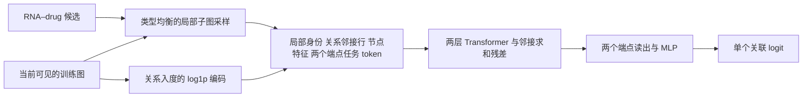

# 用异质 PENCIL 替换 GeneralConv 骨干

本轮后续同时完成了 [图结构特征编码 + TabM](GRAPH_TABM.md) 路线，推荐入口转向该方案。四架构的最终数值见 [完整对照](results/backbone_comparison_20260910/REPORT.md)。本页保留 PENCIL 实现与预设试验设计；PENCIL 不作为本轮涨点方案推荐。

本轮实现以 [PENCIL（2026）](https://arxiv.org/abs/2602.01553) 为依据的紧凑异质图适配。原 GeneralConv 骨干作为同数据、同查询训练的对照；新模型内部没有调用原 GNN，也没有在原分数上添加补丁分支。是否推荐使用新模型，以本轮完整验证结果为准。



每个候选最多采样 34 个上下文节点。前两位固定为 RNA 与 drug，其余位置按候选和随机种子采样。首先平衡两个端点的邻居类型，容量剩余时填入二跳邻居，避免药物的大量 circRNA 邻居占满预算。两个任务 token 复制端点的局部身份与邻接行，改变角色标记后加入 Transformer。

异质关系拥有独立的邻接行输入槽。每层的邻接乘法残差使用并集邻接；所有节点共享同一个固定缩放因子，保留不同邻居数量造成的总量差异。完整可见训练图的关系入度作为额外输入，补充小子图采样丢失的计数信息。它是图的派生信息，不是额外标注。

输入正交投影固定，其余特征投影、Transformer、计数编码和解码器参与训练。没有全局节点 ID 嵌入表。不同随机上下文可产生不同分数；本轮推理固定每个候选的采样种子，不声称单次输出具有严格的节点排列不变性。

本轮实验使用既有 PCA 特征与 circRNA 扩展图。`base` 指当前 PCA 输入下的原 GeneralConv/拼接解码器，**不是原论文数据与原始 938 维表达输入的原样重跑**。

两套参数在内部验证上筛选，然后冻结参数，补充 seed 0、1，与筛选用 seed 666 合并。按三个内部选定轮数的中位数在完整拟合集重训三个种子，最后评价历史外层验证。共 8 次筛选、8 次确认和 12 次外层重训。两个指标总来自同一个检查点。外层验证此前已用于研究，结果只能视为探索性证据。

每一轮训练先从目标关系与反向关系中移除整个查询批次的正边，再构建 PENCIL 的局部子图和关系计数；原模型使用完全相同的可见图。PENCIL 的小批次梯度按查询数量累加，每个 epoch 与原模型一样只有一次优化器更新。两种架构各获得两套适合自身的优化参数，因此比较的是完整训练方案，不能将全部差值单独归因于注意力算子。

实现和检索依据：

- [骨干及子图编码](pencil_backbone.py)
- [冻结训练、选择、重训与检查点重放](backbone_replacement.py)
- [六项信息隔离与数值检查](test_pencil_backbone.py)
- [近期方法检索](research/backbone_replacement_20260910/RESEARCH.md)

训练命令如下；`prepare` 只允许使用新目录。

```bash
export OMP_NUM_THREADS=4 MKL_NUM_THREADS=4 OPENBLAS_NUM_THREADS=4
PY=/data1/licheng/miniconda3/envs/ncRNAdrug/bin/python
OUT=improve/results/backbone_replacement_repeat

$PY -m unittest improve.test_pencil_backbone -v
$PY -m improve.backbone_replacement prepare --out-dir "$OUT"
$PY -m improve.backbone_replacement run --out-dir "$OUT" --stage screen --task LncDrug --device cuda:0
$PY -m improve.backbone_replacement run --out-dir "$OUT" --stage screen --task MiDrug --device cuda:1
$PY -m improve.backbone_replacement select --out-dir "$OUT" --stage screen
```

两个任务可以同时运行。筛选完成后分别将 `run` 的阶段设为 `confirm`，两任务都完成后执行 `select --stage confirm`；随后运行两任务的 `run --stage outer`，最后执行 `report --device cuda:0`，它会重放所有正式检查点并输出 `REPORT.md`、`outer_summary.csv`、`paired_deltas.csv` 和 `VALIDATION.json`。

原有源码、配置与历史结果保留。新检查点包含独立新骨干的全部参数，原骨干仍可用 `--arm base` 单独运行。
