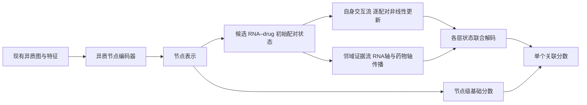

# 双流配对编码：自身交互与邻域证据并行建模

保留原 ncRNA–drug 关联预测任务、现有节点特征和关系图。该结构接续 [第一轮配对状态实验](results/pair_state_20260909/FINDINGS.md)，不引入新的生物标签或外部数据。

**实验已完成：主模型没有通过预设性能与结构互补筛选。** 24 次内部调参、50 次五种子重训及 74 个检查点重放均已完成。主模型超过固定默认原结构，但 MiDrug 的 AUC/AUPR 在 5/5 个种子上低于相同查询训练的原结构与两种同规模对照。当前结果不支持将“双流互补”作为已证实的核心贡献。数值、组件诊断与限制见 [最终结论](results/dual_pair_20260909/FINDINGS.md)。下文保留原设计假设与实现说明。

**可以围绕它组织的模型动机**

一个 RNA 节点向量需要同时服务于许多药物查询。让隐藏状态对应具体 RNA–drug 配对，能够把候选药物信息带入更早的表示处理。进一步地，配对自身的特征交互与相邻配对的关系证据可能承担不同作用：用传播完全替代自身的非线性处理，可能丢失后者的有效表达。

模型因此并行保留两条流：自身交互流逐配对更新，邻域证据流沿 RNA 关系和药物关系的两个坐标更新。两条流共享初始配对投影，使用独立的层参数，所有层的查询配对表示经共同的非线性解码器生成修正分数。节点骨干与两条流在同一个 BCE 损失下联合训练。



两条流没有实现逐层互相传递状态或注意力选择，不应这样描述。它们共享输入投影和最终解码，并在共同损失下学习。也不能把隐藏维度直接解释成已确认的耐药通路。

**形式化表达**

初始配对状态沿用上一轮特征投影，但去掉未获增量支持的显式关联边界值：

\[
H^0(r,d)=\tanh\{a_r(z_r)+a_d(z_d)+b_r(z_r)\odot b_d(z_d)\}.
\]

自身流与传播流分别更新：

\[
L^{\ell+1}=\mathcal{F}_{\ell}(L^\ell),\qquad
G^{\ell+1}=\mathcal{P}_{\ell}(G^\ell;P_{RNA},P_{drug}),\qquad
L^0=G^0=H^0.
\]

F 是逐配对残差非线性变换，P 在同样的变换框架中引入沿两个坐标的稀疏传播。最终分数为：

\[
s(r,d)=s_{node}(r,d)+
\operatorname{MLP}([H^0(r,d),L^1(r,d),G^1(r,d),L^2(r,d),G^2(r,d)]).
\]

每条流固定 16 维、两层。新分支输出层初始化为零，初始预测等于原节点模型。每个配对的状态由输入计算，参数在配对间共享，没有独立的配对 ID embedding 表。

**三组相同参数的结构对照**

| 组别 | 第一条流 | 第二条流 | 回答的问题 |
|---|---|---|---|
| dual_local | 自身交互 | 自身交互 | 额外容量是否已经足够解释收益？ |
| dual_transport | 邻域传播 | 邻域传播 | 增加传播容量是否已经足够？ |
| dual_pair | 自身交互 | 邻域传播 | 两类信息并行是否有增量？ |

三组初始化参数及分配参数数目完全相同。关闭关系传播会使部分辅助 RNA 类型的参数不影响最终查询输出，因此有效容量不能仅由参数数量完全刻画。另保留固定默认原 PCA GNN，以及使用相同查询遮边训练并调参的原 GNN。

只有 `dual_pair` 超过两种同类双流对照，才能支持两类表示互补的主张。只超过原模型，还可能由查询训练、额外容量或参数选择解释。训练后禁用传播、将自身流输出置零和关闭整个分支，分别检查预测对这些组件的依赖。

**固定实验设计**

此方案是在观察第一轮外层验证结果后提出的追加探索，协议明确记录这一点。保留原训练标签中的固定 80/20 内部分割（种子 20260912），所有可调结构各搜索学习率倍率 0.3、1、3，权重衰减固定为 0。最大轮数沿用 LncDrug 100 / MiDrug 300；每组在内部验证选择配置与最早的最高 mean(AUC,AUPR) 轮数。

配置冻结后用全部原训练标签重训，种子为 666、0、1、2、3；已有外层验证只在重训完成后评价。四个可调组共 24 次内部训练，五组共 50 次重训。各次训练均使用一个模型、一个 BCE 目标和一个最终检查点。

查询组每步抽取一半训练行，删除其中正例在目标关系与反向关系中的边。内部留出正例先从阶段支持图移除。新分支的关系算子只来自现有 RNA–RNA 与 drug–drug 图；已知 RNA–drug 关联仍经原节点骨干进入模型。

本轮不打开测试划分。已有外层验证被多轮使用，不能称为独立确认；五个初始化种子也不替代新划分验证。当前图包含既有 circRNA 扩展，不能称作原论文的原样复现。

**实现与复现**

- 模型：[dual_pair_modules.py](dual_pair_modules.py)，复用已验证的稀疏坐标算子与配对层。
- 冻结实验入口：[dual_pair.py](dual_pair.py)。为保留此前检查点的源码哈希，该入口单独冻结，未修改第一轮训练代码。
- 结构检查：[test_dual_pair.py](test_dual_pair.py)：相同初始参数与原函数保持、禁用传播等价于相应对照、两条流的联合梯度及自身流置零行为。
- 分析与重放：[analyze_pair_state.py](analyze_pair_state.py)，通过 `--experiment-module improve.dual_pair` 选择本轮。

```bash
OMP_NUM_THREADS=4 MKL_NUM_THREADS=4 OPENBLAS_NUM_THREADS=4 /data1/licheng/miniconda3/envs/ncRNAdrug/bin/python -m unittest improve.test_dual_pair -v
OMP_NUM_THREADS=4 MKL_NUM_THREADS=4 OPENBLAS_NUM_THREADS=4 /data1/licheng/miniconda3/envs/ncRNAdrug/bin/python -m improve.dual_pair prepare --out-dir improve/results/dual_pair_20260909
OMP_NUM_THREADS=4 MKL_NUM_THREADS=4 OPENBLAS_NUM_THREADS=4 /data1/licheng/miniconda3/envs/ncRNAdrug/bin/python -m improve.dual_pair run --out-dir improve/results/dual_pair_20260909 --task LncDrug --device cuda:0
OMP_NUM_THREADS=4 MKL_NUM_THREADS=4 OPENBLAS_NUM_THREADS=4 /data1/licheng/miniconda3/envs/ncRNAdrug/bin/python -m improve.dual_pair run --out-dir improve/results/dual_pair_20260909 --task MiDrug --device cuda:1
OMP_NUM_THREADS=4 MKL_NUM_THREADS=4 OPENBLAS_NUM_THREADS=4 /data1/licheng/miniconda3/envs/ncRNAdrug/bin/python -m improve.dual_pair select --out-dir improve/results/dual_pair_20260909
OMP_NUM_THREADS=4 MKL_NUM_THREADS=4 OPENBLAS_NUM_THREADS=4 /data1/licheng/miniconda3/envs/ncRNAdrug/bin/python -m improve.dual_pair run --out-dir improve/results/dual_pair_20260909 --stage outer --task LncDrug --device cuda:0
OMP_NUM_THREADS=4 MKL_NUM_THREADS=4 OPENBLAS_NUM_THREADS=4 /data1/licheng/miniconda3/envs/ncRNAdrug/bin/python -m improve.dual_pair run --out-dir improve/results/dual_pair_20260909 --stage outer --task MiDrug --device cuda:1
OMP_NUM_THREADS=4 MKL_NUM_THREADS=4 OPENBLAS_NUM_THREADS=4 /data1/licheng/miniconda3/envs/ncRNAdrug/bin/python -m improve.analyze_pair_state --experiment-module improve.dual_pair --out-dir improve/results/dual_pair_20260909 --device cuda:0
```

已冻结目录使用 run 续跑，不再次 prepare。两个任务可分别在两张 GPU 上运行，select 必须等待全部内部训练完成。

**故事应该落在哪里**

可检验的主张是：保留完整的配对自身交互，同时沿关系图传播配对证据，能比任一种同类容量扩展更好地预测关联。对应的论文叙述可以依次解释共享节点表示的限制、两种配对信息的不同作用、稀疏双轴传播的实现，以及同类双流对照能否排除容量解释。

配对表示、图矩阵补全、多分支/残差网络和条件路径推理已有先例，参见 [前一轮的文献归属](PAIR_STATE.md)。本方案不宣称这些组件首次提出；结果也不能用于证明真实生物因果路径。
