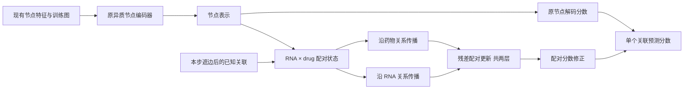

# 节点与配对联合编码：保留原任务的结构改动

本轮 98 次正式训练及全部检查点重放已完成，完整主候选未通过性能和机制筛选。具体结果见 [FINDINGS.md](results/pair_state_20260909/FINDINGS.md)。基于这次比较的后续结构为 [双流配对编码](DUAL_PAIR.md)。

目标仍是现有 ncRNA–drug 关联预测，沿用工作区的图、特征与关联标签。本轮不切换到方向预测或干预预测，也不新增外部生物数据。正式实验目录为 [pair_state_20260909](results/pair_state_20260909)。

**结构动机**

原模型为每个 RNA 和药物生成一个节点向量，再把两个向量拼接后打分。推理时，同一 RNA 的节点向量供所有候选药物共享，具体配对的交互主要在解码器中发生。已有的路径注意力实验改变了少量中介节点在解码时的池化，但配对状态自身没有进行多层传播。

本轮同时保留节点表示和 RNA–drug 配对表示。每个配对有一个由当前特征与图计算的隐藏状态，共享网络参数；没有为每个配对分配独立可训练的 ID 向量。RNA 关系改变配对的 RNA 坐标，药物关系改变药物坐标，多层更新组合两侧证据。



这是一种联合训练的结构，不是训练多个模型后做预测集成。新分支输出层初始化为零，使初始函数等于原模型；随后节点编码器和配对分支在同一个 BCE 目标下共同更新。

**实现对应的公式**

对 RNA 类型 t，配对场 H_t 的形状为 N_t × N_drug × w。用原骨干的节点表示 z 初始化：

\[
H^0_t(r,d)=\tanh\{a_t(z_r)+a_D(z_d)+b_t(z_r)\odot b_D(z_d)
                     +B_t(r,d)e_t\}.
\]

B 是本步支持图中的已知关联指示矩阵，e_t 是可学习向量。B = 0 表示当前支持图没有该边，不表示已经实验证明不存在关联。`pair_features` 对照去掉这一显式边界项；原骨干仍可访问相同支持图。

RNA 侧传播由入边均值算子 P_tau 沿第一个坐标执行；药物侧传播由 P_D 沿第二个坐标执行。对每一层，合并自状态、各类 RNA 关系消息及药物关系消息，经 LayerNorm、GELU 和可学习残差步长更新。解码器读取所查询配对的各层状态：

\[
s(r,d)=s_{\mathrm{node}}(r,d)+
       \operatorname{MLP}([H^0_t(r,d),H^1_t(r,d),H^2_t(r,d)]).
\]

相邻配对的隐藏值依赖它们各自的 RNA 和药物，因此传播内容具有配对条件。模型没有实现配对相关的边注意力，不应把它描述为此类注意力方法。

配对分支使用 lncRNA、miRNA 的同类及跨类型关系，以及已有 drug–drug 关系；circRNA 仍通过原节点骨干参与。只在新分支使用归一化传播，原 GNN 的求和尺度与关系 min/mean 融合保留。新分支移除相似关系的自环，由独立自状态变换承担自身信息。

实现不显式构建巨大配对图。两个轴分别做稀疏矩阵乘法，主要传播代价随 E_R × N_D × w 和 E_D × N_R × w 增长，配对状态本身需要 O(N_R × N_D × w) 内存；通道线性变换另有 O(N_R × N_D × w²) 代价。本轮固定 w = 16、深度为 2。

**怎样判断结构是否有价值**

| 组别 | 作用 |
|---|---|
| pca_default | 原 PCA GNN，固定原学习率及 100/300 个 epoch，作为稳定的原模型参考 |
| pca_query | 原 PCA GNN，同样的查询抽样与双向遮边，隔离训练方式的收益 |
| pair_local | 相同参数的配对分支，把坐标传播替换成逐配对变换，检验额外非线性容量 |
| pair_features | 配对传播，但不显式注入支持关联边界值 |
| pair_state | 完整节点/配对联合编码，预设主候选 |

三种配对分支分配的参数数量和初始数值一致；关闭坐标传播或边界项会使部分参数不参与对照的输出，不能把“分配参数相同”解释为有效容量完全相同。

主候选需要在两个任务上同时超过固定原模型和调参后的查询训练对照；配对传播的主张还需要超过 `pair_local`。只有超过 `pair_features`，才支持显式支持关联边界值的增量贡献。训练后再禁用传播或边界值的实验只用于检查预测依赖，不作为生物机制或因果证据。

**训练和数据隔离**

沿用此前核验过的输入，在原训练标签中使用新固定种子 20260912 划分 80% 拟合集和 20% 内部验证集。四个可调组各使用六组参数：学习率倍率 0.3/1/3 × 权重衰减 0/1e-4。各任务的宽度、最大训练轮数、优化器、标签和损失相同。

内部验证只选择一个配置和一个最早达到最高 mean(AUC,AUPR) 的 epoch。随后用全部原训练标签、固定所选轮数重训，种子为 666、0、1、2、3，再评价已有外层验证集。固定默认组不参与调参。总计 48 次内部调参、50 次重训。

每步对查询组分层抽取一半训练行，删除其中查询正例的正向与反向边，再构建所有输入。配对边界值每次由当前遮边后的图重建，没有缓存未遮边的目标标签矩阵。内部留出的正例先从该阶段的支持图中剔除。其他类型的已知关联与原骨干保持一致。

本轮不打开测试划分。已有外层验证集被此前试验反复使用，仍只能支持探索性结论；五个初始化种子也不是五个独立数据划分。工作区的图包含既有 circRNA 扩展，不能称作原论文的原样复现。

**检验与复现**

7 项机制检查覆盖：两个坐标算子与显式乘积图的前向/梯度等价、矩形及空关系、双向遮边后的边界重建、零初始化的原函数保持、支持信息传播范围、节点重编号/查询分块一致性，以及联合反向传播。

18 次短训及完整检查点重放已通过，结果位于 [短训验证记录](results/pair_state_20260909_smoke/VALIDATION.json)。短训分数不用于判断模型性能。

```bash
OMP_NUM_THREADS=4 MKL_NUM_THREADS=4 OPENBLAS_NUM_THREADS=4 /data1/licheng/miniconda3/envs/ncRNAdrug/bin/python -m unittest improve.test_pair_state -v
OMP_NUM_THREADS=4 MKL_NUM_THREADS=4 OPENBLAS_NUM_THREADS=4 /data1/licheng/miniconda3/envs/ncRNAdrug/bin/python -m improve.pair_state prepare --out-dir improve/results/pair_state_20260909
OMP_NUM_THREADS=4 MKL_NUM_THREADS=4 OPENBLAS_NUM_THREADS=4 /data1/licheng/miniconda3/envs/ncRNAdrug/bin/python -m improve.pair_state run --out-dir improve/results/pair_state_20260909 --task LncDrug --device cuda:0
OMP_NUM_THREADS=4 MKL_NUM_THREADS=4 OPENBLAS_NUM_THREADS=4 /data1/licheng/miniconda3/envs/ncRNAdrug/bin/python -m improve.pair_state run --out-dir improve/results/pair_state_20260909 --task MiDrug --device cuda:1
OMP_NUM_THREADS=4 MKL_NUM_THREADS=4 OPENBLAS_NUM_THREADS=4 /data1/licheng/miniconda3/envs/ncRNAdrug/bin/python -m improve.pair_state select --out-dir improve/results/pair_state_20260909
OMP_NUM_THREADS=4 MKL_NUM_THREADS=4 OPENBLAS_NUM_THREADS=4 /data1/licheng/miniconda3/envs/ncRNAdrug/bin/python -m improve.pair_state run --out-dir improve/results/pair_state_20260909 --stage outer --task LncDrug --device cuda:0
OMP_NUM_THREADS=4 MKL_NUM_THREADS=4 OPENBLAS_NUM_THREADS=4 /data1/licheng/miniconda3/envs/ncRNAdrug/bin/python -m improve.pair_state run --out-dir improve/results/pair_state_20260909 --stage outer --task MiDrug --device cuda:1
OMP_NUM_THREADS=4 MKL_NUM_THREADS=4 OPENBLAS_NUM_THREADS=4 /data1/licheng/miniconda3/envs/ncRNAdrug/bin/python -m improve.analyze_pair_state --out-dir improve/results/pair_state_20260909 --device cuda:0
```

已存在的实验不能再次 prepare；使用 run 恢复相应阶段。两个任务的 worker 可并行运行，选择参数需要等待两任务全部内部调参完成。协议、源代码、输入、结果和检查点均有哈希记录；改变已冻结代码将拒绝续跑。

**论文表述的边界**

可以提出的待检验主张是：“在节点编码之外引入配对状态的多层关系传播，能够更好地组合 RNA 侧和药物侧的关联证据。”是否成立以匹配对照为准。若只是 `pair_local` 改善，则不能将收益归于配对传播；若 `pair_features` 已解释全部改善，则应删除边界值带来增益的说法。

配对表示、图矩阵补全、共同邻居池化和条件路径推理都有先例。本轮不是“首次让配对参与图学习”，也没有证明严格更强的表达力。已核对的相关工作：

- [Graph Convolutional Matrix Completion](https://arxiv.org/abs/1706.02263)：二部交互图上的消息传递与矩阵补全。
- [Neural Bellman-Ford Networks](https://arxiv.org/abs/2106.06935)：以边界、消息和聚合算子学习配对路径表示。
- [Neural Common Neighbor with Completion](https://arxiv.org/abs/2302.00890)：节点传播后用结构与共同邻居构建链接表示；工作区已存在相关实现。
- [GSLRDA](https://doi.org/10.1021/acs.jcim.2c00367)：本任务中已有图网络与自监督研究。

出处元数据与摘要保存在 [verified_prior_art.json](research/pair_state_20260909/verified_prior_art.json)。这些核对用于准确归属已有思想，不能据此证明剩余组合具备全球首次新颖性。
