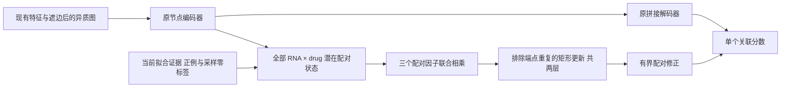

# 矩形闭环编码：联合三个配对状态推断第四个

2026-09-10。保留当前 ncRNA–drug 关联预测任务、现有特征与图。**24 次正式训练及全部检查点重放已完成，矩形乘法主候选未通过性能和机制筛选。** LncDrug 的简单加法对照有有限全局收益，详细数值与限制见 [试验结论](results/rectangle_completion_20260910/FINDINGS.md)。本方案不宣称首次提出高阶图学习；下文保留结构假设与固定试验设计。

**结构假设**

此前配对编码沿固定 RNA 相似关系和药物相似关系传播。新的假设是：另一种可用证据来自三个配对的共同排列，而不只来自独立的邻居均值。例如，RNA r 与药物 e、RNA s 与药物 e、RNA s 与药物 d 的配对模式，可能有助于预测 r 与 d。三个条件是否共同成立需要联合建模。

但不能只数已有正边。固定内部划分上，约 60% 的 LncDrug 留出正例 RNA 没有其他拟合正关联，直接数三步目标关联路径无法覆盖它们。模型因此为全部 lncRNA–drug 和 miRNA–drug 配对生成特征驱动的潜在状态；已知拟合标签另外作为证据输入。潜在状态不是已经确认的关联，也不是硬伪标签。

原始图统计和适用范围保存在 [structural_audit.json](research/rectangle_completion_20260910/structural_audit.json)。这些诊断不能证明补全会有效，也不能给出性能上限。



**核心算子**

设 H 为 RNA × drug × 通道的配对张量，由原节点表示的类型专属投影、两侧逐通道乘积和证据嵌入初始化。每层把 H 映射为三个 tanh 有界因子 A、B、C。对候选 (r,d)，逐通道计算：

\[
M_{rd}=\frac{1}{(N_R-1)(N_D-1)}
\sum_{s\ne r}\sum_{e\ne d}
A_{re}\odot B_{se}\odot C_{sd}.
\]

中间 RNA s 可以来自 lncRNA 或 miRNA。三者的乘积表达联合模式；仅增加某一边的数值不会等价于增加整个闭环的支持。

不枚举四元组。逐通道先计算 ABᵀC，再减去 s=r 和 e=d 的项、加回交集，最后除以合法组合数。按当前 N_D < N_R，先算 BᵀC，可把中间矩阵限制为 drug × drug。核心乘法代价为 O(w N_R N_D²)，配对状态内存为 O(w N_R N_D)。这不是线性时间方法。

消息经 LayerNorm 后与当前状态拼接，由 MLP 和可学习残差步长更新。两层后把查询配对的各层状态读出为修正项：

\[
s(r,d)=s_{\mathrm{original}}(r,d)+\tanh f([H^0_{rd},H^1_{rd},H^2_{rd}]).
\]

最后一层零初始化，初始函数与原模型一致。训练前 20% 轮数逐渐启用修正，推理使用完整修正。限制修正幅度只是数值设计，不能保证性能不会下降。

排除 s=r、e=d 使单个基础消息没有直接读取查询因子 A_rd、B_rd、C_rd；多层网络仍可能通过其他位置间接依赖前层查询状态，不能声称完全消除了自反馈。

**对照与判断**

| 组别 | 设置 | 要区分的解释 |
|---|---|---|
| pca_query | 原 PCA GNN、原解码器、相同查询遮边 | 相对强原模型是否提高 |
| additive | 相同配对状态、证据、层数、参数与初始化；把三因子乘积换成三因子均值 | 更多容量与边际信息是否已经足够 |
| rectangle | 三因子乘积、排除重复端点 | 联合配对排列是否带来额外信息 |

加法对照也观察另外三个位置，并使用相同的排除规则；它能聚合 RNA 行、药物列和其余矩阵的边际信息，但不保留三者的乘法对应。两组分配参数数目一致，不代表函数容量完全相同。

每组两种学习率设置，先用 seed 666 选择一种，再用 seed 0、1 确认，共 24 次正式训练。LncDrug 150 轮、MiDrug 450 轮；各次运行以最早达到最高的连续五轮内部 mean(AUC,AP) 选择一个检查点。原模型获得相同搜索预算。

性能要求分别超过本轮调参原模型与上一轮较强原模型；每个比较需平均 AUC/AP 均为正、至少 2/3 种子 mean(AUC,AP) 改善。结构主张还需要超过加法对照。按药物宏平均 AP 必须同步报告。若只有全局 AP 上升，不能称为全面改善或证明机制正确。

**数据边界**

仅复用原拟合标签中的固定 80/20 内部划分。每步查询抽取一半拟合行，正例从目标关系及反向边删除；显式证据还删除查询零标签。已知正例、采样零标签和未知配对分开编码，零标签不能解释为药物敏感。

其他 RNA 任务的既有关联沿用单任务协议；circRNA 仍参与原骨干，不进入新配对张量。本轮不读取外层验证或测试数组。内部验证已经多次用于开发，结果属于探索性；三个初始化不代替新划分。

**新颖性边界**

NCNC 已研究以预测补全缺失邻居；高阶链接编码、矩阵补全与乘法配对更新也有先例。同任务的 HDBI 已提出高阶动态解耦与双向更新。因此不能用“高阶”“补全”“双向”等名称直接主张创新。

本轮具体检验的是：跨 RNA 类型的潜在二部配对场、排除重复端点的三配对乘法、显式拟合证据与查询隔离的组合，是否在当前任务上有可重复的增量。已核验的论文元数据与摘要及先例范围见 [新颖性判断](research/rectangle_completion_20260910/NOVELTY.md)。当前没有系统全文查新或全球首次证明。

**代码与复现**

- [核心模型](rectangle_modules.py)
- [七项数值与信息隔离检查](test_rectangle.py)
- [冻结训练与检查点重放入口](rectangle_pilot.py)

```bash
OMP_NUM_THREADS=4 MKL_NUM_THREADS=4 OPENBLAS_NUM_THREADS=4 /data1/licheng/miniconda3/envs/ncRNAdrug/bin/python -m unittest improve.test_rectangle -v
OMP_NUM_THREADS=4 MKL_NUM_THREADS=4 OPENBLAS_NUM_THREADS=4 /data1/licheng/miniconda3/envs/ncRNAdrug/bin/python -m improve.rectangle_pilot prepare --out-dir improve/results/rectangle_completion_20260910
OMP_NUM_THREADS=4 MKL_NUM_THREADS=4 OPENBLAS_NUM_THREADS=4 /data1/licheng/miniconda3/envs/ncRNAdrug/bin/python -m improve.rectangle_pilot run --out-dir improve/results/rectangle_completion_20260910 --stage screen --task LncDrug --device cuda:0
OMP_NUM_THREADS=4 MKL_NUM_THREADS=4 OPENBLAS_NUM_THREADS=4 /data1/licheng/miniconda3/envs/ncRNAdrug/bin/python -m improve.rectangle_pilot run --out-dir improve/results/rectangle_completion_20260910 --stage screen --task MiDrug --device cuda:1
OMP_NUM_THREADS=4 MKL_NUM_THREADS=4 OPENBLAS_NUM_THREADS=4 /data1/licheng/miniconda3/envs/ncRNAdrug/bin/python -m improve.rectangle_pilot select --out-dir improve/results/rectangle_completion_20260910
OMP_NUM_THREADS=4 MKL_NUM_THREADS=4 OPENBLAS_NUM_THREADS=4 /data1/licheng/miniconda3/envs/ncRNAdrug/bin/python -m improve.rectangle_pilot run --out-dir improve/results/rectangle_completion_20260910 --stage confirm --task LncDrug --device cuda:0
OMP_NUM_THREADS=4 MKL_NUM_THREADS=4 OPENBLAS_NUM_THREADS=4 /data1/licheng/miniconda3/envs/ncRNAdrug/bin/python -m improve.rectangle_pilot run --out-dir improve/results/rectangle_completion_20260910 --stage confirm --task MiDrug --device cuda:1
OMP_NUM_THREADS=4 MKL_NUM_THREADS=4 OPENBLAS_NUM_THREADS=4 /data1/licheng/miniconda3/envs/ncRNAdrug/bin/python -m improve.rectangle_pilot report --out-dir improve/results/rectangle_completion_20260910 --device cuda:0
```

两个任务可以并行；select 必须等待两任务 screening 完成。源码和输入在 prepare 时冻结。保留原实验目录，不在已有协议上改模型或覆盖结果。
