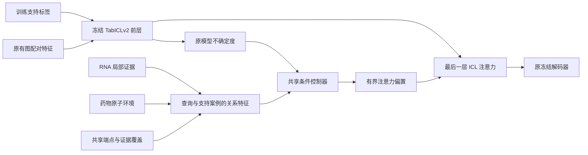

# CARE-TabICL：共享条件关系注意力

2026-09-13。目标是在当前图上下文 TabICLv2 上提高 MiDrug，同时保持 LncDrug 的 AUC、AP 不下降。**前两轮均未满足全部要求，尚不替换现有模型。** 首轮 16 个候选完成内部评价和 21 个状态重放，未通过较强参考门槛，选择 `zero`。第二轮单独冻结有界强度/置信度调整，内部通过、外层失败，见 [后续实验](results/tabicl_care_refine_20260913/)。

第二轮内部选择 `trust=10、200 步、置信度指数 0.5、α=2`。外层 MiDrug 三种子平均 AUC/AP 比图上下文参考上升 0.000081176/0.000133412，均为 3/3 种子正向；LncDrug AUC/AP 差值为 −0.000034793/−0.000000085，AUC 为 3/3 种子下降，因此严格判定失败。该轮内部、外层共 42 个拟合状态全部重放，最大预测差为 0。见 [完整外层报告](results/tabicl_care_refine_20260913/REPORT_outer.md)。

第三轮 **CARE-RO** 已完成：12 个候选全部未通过内部共同门槛，选择 `zero`，没有进入该轮外层。支持比例归一化减小了输入分布偏移，排序约束减小了训练排序扰动，但这些没有转化为合格的双任务提升。该轮 21 个上下文状态重放误差均为 0。见 [CARE-RO 说明](TABICL_CARE_RO.md) 和 [报告](results/tabicl_care_rank_20260913/REPORT_inner.md)。

三轮共 40 组候选评估、84 个保存的上下文状态重放。当前保留图上下文 TabICLv2；不能把 MiDrug 的小幅提高描述成已满足双任务目标。汇总见 [最终记录](TABICL_CARE_FINDINGS.md)。

首轮 `trust=1、50 步、α=1` 相对图上下文参考，同时提高两任务的 AUC/AP：MiDrug 为 +0.000019081/+0.000017181，LncDrug 为 +0.000010395/+0.000065557。但 LncDrug AP 仍低于原始 TabICLv2，因此没有降低筛选条件或直接进入外层。完整数字见 [首轮报告](results/tabicl_care_20260913/REPORT_inner.md) 和 [冻结选择](results/tabicl_care_20260913/SELECTION.json)。

此前固定局部匹配提高 MiDrug、损伤 LncDrug，因此这次学习一个小型的查询条件控制器。两个任务使用同一组适配器权重，没有任务 ID、RNA 类型、RNA 长度或实体身份嵌入，也没有 LncDrug 专用恒等路径。基础 TabICLv2 和已有实体编码器保持冻结。



**关系表示。** 对每个查询配对和训练支持配对，形成五个特征：RNA 局部匹配、药物局部匹配、两者乘积、是否共享 RNA、是否共享药物。匹配分数仅在该查询的支持案例上归一化，缺失证据置零。原整数编号仅用于查找证据和判断端点相同；一致重命名编号不改变计算。

**条件控制器。** 输入六个支持数量、覆盖和匹配分散度统计，以及原模型的绝对分类间隔和不确定度。一个 16 维隐层产生五个关系系数，加上五个全局系数，共 234 个参数。它只改变已有 ICL 注意力，不单独输出分类结果。

设关系向量为 `φ(q,s)`，原模型的二分类绝对 logit 间隔为 `m(q)`，则

\[
u(q)=4\sigma(m(q))\sigma(-m(q)),\qquad
c_\theta(q)=\tanh\{c_0+f_\theta(q)\},
\]

\[
b_\theta(q,s)=2\alpha u(q)\tanh\left[
\frac{c_\theta(q)^\top\phi(q,s)}{2\sqrt{5}}
\right].
\]

每个注意力 logit 的改动绝对值不超过 `2α`。不确定度对成员的类别置换不变。小改动和高置信度收缩不构成正确率保证，是否采用仍由预设验证条件决定。

**训练边界。** 从每个原五折遮边图对应的拟合行中，再划分支持和伪查询。一个 episode 的所有行都来自同一原折，该折的全部目标边已从图中排除；这避免其他折的支持特征把当前伪查询目标边带回训练。每任务五折、每折两个互补 episode，每个 episode 至多 256 个伪查询、4 个推理成员。优化器只读取拟合标签。

两个任务交替训练。损失是分类交叉熵、权重 0.25 的配对排序损失及对冻结原输出的 KL 约束；LncDrug 的 KL 权重为 MiDrug 的四倍。两任务仍更新同一个适配器。固定比较 KL 系数 1/10、训练步数 50/200、推理强度 0.03125/0.125/0.5/1，共 16 个共享候选。另训练相同输入的池化对照、去掉查询条件控制器的常系数对照；后者只有五个实际参与计算的系数。

**选择与评价。** 使用 seed 666/0/1，各 32 个推理成员。LncDrug 的平均 AUC/AP 必须分别不低于原始 TabICLv2 和图上下文参考；MiDrug 平均 AUC/AP 必须超过图上下文，每项至少两个种子为正差值。通过者优先取较低强度、更强 KL 和更少训练步数，而非追求最大涨幅。按药物宏 AP 完整报告，默认不参与筛选；`prepare --protect-macro` 可将其也设为硬约束。

只有完整内部重放、查询独立性检查和冻结选择通过后，才能加载本轮外层数组。外层保留相同共享适配器，仅按原基线协议扩充 TabICL 支持上下文，同时报告选定适配器与两个机制对照，不重新选参。

**工程验证。** 核心检查覆盖零初始化恢复、真实注意力层梯度、主干冻结、改动幅度、类别置换、支持换序、查询独立性、实体重命名、缺失证据及失败选择阻止外层加载。GPU 短流程的七个拟合状态重放误差为零；模型实际改变概率。当前 PyTorch 2.5.1 的短查询注意力反向传播存在对齐错误，因此适配器训练使用数学 SDPA，推理保留原官方计算路径。失败短流程和修复后记录都保留，发生于正式指标查看之前。

实现：[共享适配器](tabicl_care_modules.py)、[训练及评估入口](tabicl_care.py)、[边界检查](test_tabicl_care.py)。固定协议和后续结果保存在 [实验目录](results/tabicl_care_20260913/)。

在仓库目录复现，使用新的输出目录：

```bash
export OMP_NUM_THREADS=4 MKL_NUM_THREADS=4 OPENBLAS_NUM_THREADS=4
CARE_PY=/data1/licheng/incrd-hg/.venv-tabicl/bin/python
CARE_OUT=improve/results/tabicl_care_repeat
"$CARE_PY" -m unittest improve.test_tabicl_care -v
"$CARE_PY" -m improve.tabicl_care prepare --out-dir "$CARE_OUT"
for task in LncDrug MiDrug; do
    "$CARE_PY" -m improve.tabicl_care cache --out-dir "$CARE_OUT" --task "$task" --device cuda:0
done
"$CARE_PY" -m improve.tabicl_care train --out-dir "$CARE_OUT" --device cuda:0
for command in run verify audit; do
    for task in LncDrug MiDrug; do
        "$CARE_PY" -m improve.tabicl_care "$command" --out-dir "$CARE_OUT" --task "$task" --device cuda:0
    done
done
"$CARE_PY" -m improve.tabicl_care select --out-dir "$CARE_OUT"
"$CARE_PY" -m improve.tabicl_care report --out-dir "$CARE_OUT"
```

若内部选择通过，对 `run`、`verify`、`audit`、`report` 加 `--phase outer` 完成外层评价。不同任务的缓存和评价可分配到不同 GPU；共享适配器训练需在两任务缓存完成后运行。

这是一种在当前项目中新增的条件关系适配架构，不声称条件门控、信任约束或注意力偏置本身全球首创。历史验证已多次参与开发；推理种子不是独立数据划分。该实验不打开原始测试数组，也不证明新家族、新药物骨架或跨任务参数迁移效果。
