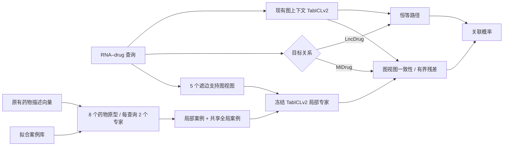

# MiDrug 专用药物记忆 TabICL

2026-09-12。目标是在当前最强的[图上下文 TabICLv2](TABICL_GRAPH_CONTEXT.md)之上增强 MiDrug，且 LncDrug 不下降。原型采用 **MDM-TabICL（MiDrug Drug-Memory TabICL）**：稳定全局分支、药物路由的局部上下文专家、图视图一致性门控。

**当前状态：停止于内部验证，未进入正式外层实验。** 51 个正式内部专家状态、17 个候选的三种子比较已完成，没有候选同时通过平均 AUC/AP 提升和两个种子正差值的条件，内部选择保留原模型。13 项单元检查和工程短流程的 14 个状态重放通过，但工程短流程成绩不作为性能证据。正式内部状态尚未逐一重放，不声称完整正式核验完成。

用户进一步明确要求两个任务共用、具有通用迁移机制的架构，因此不再推进依赖任务恒等分支的本原型。源码和内部负结果保留；新方向见[miRNA 与跨领域机制检索](research/mirna_general_architecture_20260912/PROPOSAL.md)。

## 结构



LncDrug 的恒等路径在新实验前固定，不由验证成绩决定，也不与新分支共享可更新参数。它直接返回原图上下文预测，因此其 AUC、AP、按药物宏 AP 均保持原值。保护的是已有模型的预测行为，不是对新数据准确率的保证。

MiDrug 的全局参考为上一轮内部选定的 `fold_match_050`，LncDrug 为 `query_bag_050`。新实验以这两个较强版本为对照，而不是回退到更弱的原始 TabICLv2。

## 药物记忆

使用原有 216 种药物的 768 维描述向量，归一化后以固定种子建立 8 个 K-means 原型。每个原型按药物余弦相似度检索 1,792 个拟合配对，再加入共享的 256 行随机全局案例，共 2,048 行。检索和全局抽样均不使用标签；检索后检查上下文包含两类。

每个查询按其药物与原型的相似度，路由到最近两个专家，温度 0.1 的 softmax 决定两者权重。同一药物的查询共享路由，RNA 差异由配对特征和 ICL 处理。路由不依赖同批其他查询，也不需要查询标签。

上下文保留原五折图特征，查询分别使用五个已核验的遮边支持图视图。所有目标查询正边及反向边均已从支持图排除。局部上下文混合原五折行，继承原 `query_bag` 分支的图特征政策；它不是每个专家重新建立一套完全同图的上下文。

比较两种局部输入：

| 组成项 | ICL 输入 | 上下文 |
|---|---|---|
| `drug_graph` | 原有 36 维图配对特征 | 药物路由的局部案例 |
| `drug_side` | 36 维图特征 + 8 维 RNA PCA + 8 维 drug PCA | 相同局部案例 |
| `global_side`，对照 | 相同 52 维输入 | 全部拟合案例 |

RNA PCA 来自原输入，drug PCA 仅从原有实体属性拟合。没有新增生物数据，也没有更新官方 TabICLv2 参数。所有正式专家使用原 FP32 设置和 32 个推理成员。

## 有界修正

先在每个图视图内按两位专家的路由权重聚合，得到五个概率 `p_v(q)`，再取均值 `p_local(q)`。令原分支概率为 `p0(q)`：

\[
g(q)=\frac{\max_k\cos(d_q,c_k)}{1+\operatorname{std}_v\{\operatorname{logit}p_v(q)\}},
\]

其中余弦可靠度截断到 `[0,1]`。新输出为

\[
p(q)=\sigma\left(\operatorname{logit}p_0(q)+
\alpha g(q)\operatorname{clip}\left[\operatorname{logit}p_{local}(q)-\operatorname{logit}p_0(q),-2,2\right]\right).
\]

单个 logit 的修正不超过 `2α`。同时比较 `g=1` 的无一致性门控对照。零强度、零可靠度和 LncDrug 路径直接返回原概率，避免 logit/sigmoid 往返误差。

幅度限制本身不保证 MiDrug 性能不下降，必须通过同划分比较判断。

## 选择和证据

MiDrug 的两个局部输入分别比较一致性/均匀门控和 `α∈{0.05,0.10,0.20,0.35}`，加上恒等候选，共 17 个固定候选。全部使用 seed 666/0/1 内部验证。候选必须同时提高平均 AUC、AP，且每项至少两个种子差值为正；合格候选中按平均 `(AUC+AP)/2` 选择。完全同分时优先较小修正，再按 ID。

选择文件冻结后才允许打开本轮外层数组。外层额外报告相同修正强度下的全局案例对照、去掉侧信息对照和均匀门控对照；不根据外层成绩更换方案。全部拟合状态和输入变换保存，重载后重放预测，并逐项检查 LncDrug 分数与现有参考完全相同。

这是一个任务层面的新组合架构。原型检索、局部 ICL、残差门控均有既有方法背景，本实验不声称全球首次提出这些算子，也不把冻结模型称为重新训练的基础模型。历史内部/外层划分都已多次用于开发；测试数组保持未读取，三个推理种子不能替代独立数据划分。

## 复现

在 `iNcRD-HG` 目录运行，使用新的输出目录：

```bash
export OMP_NUM_THREADS=4 MKL_NUM_THREADS=4 OPENBLAS_NUM_THREADS=4
MEMORY_PY=/data1/licheng/incrd-hg/.venv-tabicl/bin/python
MEMORY_OUT=improve/results/tabicl_midrug_memory_repeat
"$MEMORY_PY" -m unittest improve.test_tabicl_midrug_memory -v
"$MEMORY_PY" -m improve.tabicl_midrug_memory prepare --out-dir "$MEMORY_OUT"
"$MEMORY_PY" -m improve.tabicl_midrug_memory pipeline --out-dir "$MEMORY_OUT" --devices cuda:0,cuda:1
```

工程短流程在 prepare 时加 `--smoke`。可单独运行 `cache`、`run`、`select`、`evaluate`、`verify`、`report`；内部选择必须在外层缓存前完成。

实现：[局部记忆与门控](tabicl_midrug_memory_modules.py)、[实验与预测 API](tabicl_midrug_memory.py)、[边界检查](test_tabicl_midrug_memory.py)。`MidrugMemoryPredictor.predict` 接收原全局概率、同一实体编号下的查询配对和五份 36 维图查询特征；LncDrug 只需提供原概率。
