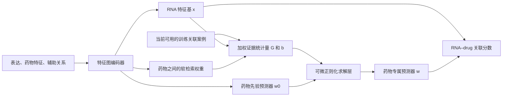

**建议检验的结构：用已知关联作为支持案例，在预测时生成药物专属的预测规则。**

**后续性能结果已完成：27 次正式训练和全部检查点重放后，当前固定原型未涨点。LncDrug、MiDrug 相对同设置原模型的平均 AP 分别下降 1.83、3.26 个百分点，性能与机制筛选均未通过。见 [完整实验结论](../../results/support_operator_20260910/FINDINGS.md)。下文保留性能初筛前的设计和工程验证记录，不将原先的待验证假设写成已经成立的贡献。**

随后另完成了 [局部案例误差适配补救](../../LOCAL_SUPPORT.md)：32 次正式训练已补回初版跌点，LncDrug 的整体 AP 小幅提高，但双任务、双指标提升筛选仍未通过。两个版本的结构与结果分别保留，避免混淆。

仍然预测 ncRNA–drug 关联，使用现有表达、药物特征和关系数据。主改动是将目标关联从编码器的消息边转为一个显式支持集，并用可微求解层替换固定的拼接 MLP。它与此前的配对状态传播、双流残差模型不同；可微求解、超网络和检索各自都有先例，当前不能宣称首创或已提高性能。

在最初原型阶段，已实现 rank=16 的解码器，7 项数值/信息边界检查通过，并在两个任务的内部拟合集上各完成 4 步真实图反向传播。**这些只证明原型可运行；该阶段尚无内部留出、外层验证或测试集的性能结果。后续初筛结果见上方更新。**

**为什么值得换这个结构**

最近配对状态、双流和调参三轮共 294 次正式训练，没有支持两个任务上稳定的总体结构增益。最新双流模型关闭邻域传播后，AUPR 变化为 LncDrug −0.000156、MiDrug +0.000036。这个结果提示需要直接检验已知关联证据是否被有效利用，而不能据此断言传播失败的生物学原因。完整历史见 [结构实验结论](../../STRUCTURAL_MODEL_FINDINGS.md) 和 [调参结论](../../results/dual_pair_tuning_20260910/FINDINGS.md)。

本轮另做了固定图路径诊断。限制支持路径为“同类 RNA 相似边 → 当前拟合正关联 → 药物相似边”，删除两端自环，要求支持案例的 RNA 和 drug 均不同于查询端点：

| 内部留出诊断 | LncDrug | MiDrug |
|---|---:|---:|
| 拟合正关联数 | 1,013 | 2,589 |
| 内部查询数 | 760 | 1,943 |
| 至少有一个该类支持案例的查询 | 10 | 409 |
| 覆盖率 | 1.32% | 21.05% |

这个路径覆盖率仅针对上述路径，未涵盖跨 RNA 类型、circRNA 或全部多跳路径。它提供“不要只靠现有硬相似边挑案例”的动机，不证明神经软检索一定有效。

同一内部留出中，仅用端点度数构造的固定分数在 MiDrug 上已达到 AUC 0.920263、AP 0.891406；按度数中心化的简单传播反而较差。这提示必须区分条件关联信息与端点频率信号，不能预设去频率就能涨点。诊断数值不属于新神经模型的实验结果，见 [support_audit.json](support_audit.json)。

**结构与数据流**



1. 编码器使用原 PCA 特征和辅助图关系。当前任务的目标关联及反向关联全部移出编码器；另一任务的既有关联仍按现有单任务协议保留。这样当前目标标签的显式输入位置可以审计。不能把这个设置直接视为严格联合任务或冷启动协议。
2. 学习 RNA 特征基 `x_r = [tanh(MLP(h_r))/sqrt(k), 1]`，最后一维允许预测器有截距。药物网络给出共享参数生成的先验 `w0(d)`。
3. 对当前支持集中的源药物，按药物表示的相似性学习软检索核。它不依赖原图中是否恰好存在 DrugDrug 边，不直接使用查询标签。初版检索按目标药物进行，**没有实现 RNA–drug 配对级检索**。
4. 将检索出的带标签案例用于求解预测器，而不只是平均它们的 embedding。最终分数为 `softplus(scale) * x_rᵀ w_d + offset`，仍以查询 BCE 联合训练。

设支持集为 `S={(r_j,d_j,y_j)}`，`X` 的每行是对应 RNA 的特征基，`t_j=2y_j−1`。原型中 `y=0` 仍是数据集的采样未标记/负标签，不解释成已实验证实的药物敏感性。

对药物 d，求解：

\[
w_d=\arg\min_w \sum_{j\in S}a_{dj}(x_{r_j}^{\top}w-t_j)^2
           +\lambda_d\|w-w_0(d)\|^2,
\]

\[
G_d=X^\top A_dX,\quad b_d=X^\top A_dt,\qquad
w_d=(G_d+\lambda_d I)^{-1}(b_d+\lambda_d w_0(d)).
\]

实现使用 `torch.linalg.solve`，不显式求逆。等价更新为：

\[
w_d-w_0(d)=(G_d+\lambda_d I)^{-1}(b_d-G_dw_0(d)).
\]

这让案例相对先验的预测误差、案例的特征覆盖范围共同决定参数修正。在 `G_d` 的特征值为 σ 的方向上，先验项的保留比例为 `λ/(σ+λ)`。若某方向完全没有支持，且 `b` 来自同一批特征，它保留原先验分量。**这个性质来自经典正则化回归，本身不是新发明。**

原型的源药物检索权重为 `κ(d,s)`；源药物 s 有 `n_s` 个支持案例，则 `a_dj=κ(d,d_j)/n_dj`。先对每个源药物计算均值充分统计量，再加权组合，避免仅凭案例数量让某个源药物占据更大检索质量。总权重为 1，因此不能声称“案例越多就必然更新越强”；正则化头还接收有效支持数 `n_eff=1/Σ_j a_dj²`，其是否学会有用的收缩需要实验检验。

全支持集为空时，代码精确返回 `w0(d)`。仅目标药物没有自身案例时，仍可从其他药物软检索支持，不一定返回先验。当前结构也可能学成很大的 λ、几乎不使用支持，这必须通过消融排查。

对每种源药物预聚合 Gram 矩阵和右端项，避免建立“目标药物 × 支持案例 × 特征维数²”的张量。每个药物只需求解一个 17×17 系统。固定参数、固定辅助图下，可以更换显式支持集并重算预测器，不需要重新编码目标标签图；这不等于移除训练标签在模型参数中留下的影响，也不是机器遗忘或因果干预。

**能写的论文主张，以及不能提前写的主张**

可检验的动机是：现有方法将已知关联混入共享节点表示，未明确区分跨药物共享的预测规律与当前可用案例支持的局部适配。这里将两者放到同一个可微预测规则中，分别控制先验和支持集带来的参数更新。

若成功，贡献可以围绕“稀疏关联证据如何决定预测规则的适配方向”展开，并用稀疏药物分层、案例置换和无支持退化验证。不能把学到的参数方向命名为生物通路，不能声称负相关等于抑制调控，也不能用训练损失下降证明准确率提升。

结构改动幅度和文献新颖性是两件事。这个方案改变了目标边的输入位置和最终推断规则，属于本项目中的结构重构；但“超网络 + 检索 + 可微岭回归”的组合名称不足以证明可发表的新方法。

**近邻文献与新颖性边界**

本轮使用 `nature-academic-search` 的公开 API 回退，检索 CrossRef、arXiv、PubMed，并人工筛选标题/摘要。学术 MCP 未挂载。以下是元数据/摘要级核对，不是全文穷尽检索或新颖性认证。2026 年预印本按当前日期纳入，并明确其预印本属性。

| 工作 | 与本方案的关系 |
|---|---|
| [HyperNetworks](https://arxiv.org/abs/1609.09106), 2016 | 用一个网络生成另一个网络的参数已有先例。 |
| [Meta-learning with differentiable closed-form solvers](https://arxiv.org/abs/1805.08136), 2018 | 通过岭回归求解器反向传播、学习适合少样本适配的表示已有先例；是求解层的直接方法学来源。 |
| [Meta-Learning with Differentiable Convex Optimization](https://arxiv.org/abs/1904.03758), 2019 | 可微优化型元学习已有成熟工作。 |
| [A Retrieve-and-Read Framework for Knowledge Graph Link Prediction](https://arxiv.org/abs/2212.09724), 2022 | 查询相关检索与上下文推理不能单独称为首创。 |
| [HyperPCM](https://doi.org/10.1021/acs.jcim.3c01417), 2024 | 药物–靶点领域已有以超网络做任务条件化与迁移的工作。仅换成 ncRNA 数据不够。 |
| [Context Pooling](https://arxiv.org/abs/2507.07595), 2025 | 查询特异图池化已有先例。 |
| [PRADA-DTI](https://doi.org/10.64898/2026.01.05.697600), 2026 预印本 | 原型检索动态组合 prompts/LoRA 参数，是“检索 + 生物医学关联参数适配”的近邻。其摘要针对领域增量 DTI；本原型使用当前带标签案例的充分统计量求解线性预测器，但尚未通过全文比较确认贡献边界。 |

[Exploring the Limits of Few-Shot Link Prediction in Knowledge Graphs](https://arxiv.org/abs/2102.03419), 2021，还提醒必须与忽略支持案例的强基线比较；案例输入并不自动带来有效信息。

检索原始记录保存在本目录的 `search_results.json`、`adaptive_solver_prior_art.json`、`hyperpcm_prior_art.json` 和 `exact_biomedical_prior_art.json`。OpenAlex 和部分宽泛 PubMed 查询返回了不相关结果，未用于支持上述方法主张。

**验证时真正需要回答的问题**

| 对照/干预 | 要排除的解释 |
|---|---|
| 相同预算的强原模型，保留其正确的查询遮边训练 | 新方法的收益只是旧基线设置偏弱。 |
| 同特征编码器、同先验网络，关闭支持更新 | 收益全来自新的特征投影或药物条件化先验。 |
| 同求解器，均匀选择源药物 | 可学习软检索没有额外作用。 |
| 每个源药物内部置换支持标签，保持该药物的类别计数 | 只利用药物频率/标签比例，未利用 RNA 与结果的对应关系。该置换不保留 RNA 度数。 |
| 在固定检查点移除支持、改变支持量，并分药物支持度报告 | 适配层是否被绕过、是否只对高频药物有用。 |

初筛应同时报告整体 AUC/AP、可评估药物上的宏平均 AP，以及按**拟合支持量**预定义的药物分层。初筛后才值得进行等预算调参和多个初始化/新划分确认。不能在反复使用的外层验证集上挑结构，然后把其均值作为独立证据。若初筛选择了新结构，后续独立确认需先冻结设置；测试集继续用于最后确认。

`prior`、`uniform` 与 `adaptive` 在代码中共享同一模块定义，但部分参数在对照中不参与计算。必须报告有效参数量；不能因为总参数量相同就宣称严格匹配模型容量。出现收益后还应补充具有相近有效容量的解码器对照。

当前原型的标签边界：训练 query 的正、负案例和重复行均从支持集中删除；内部留出不进入支持；目标图边及反向边在主方案中全部清空；不同任务分别运行。支持特征和检索只能由当前可用输入构造，不能把待预测标签缓存到统计量中。

**已落地内容与复现**

- [support_operator_modules.py](../../support_operator_modules.py)：RNA 特征基、药物先验、软检索、可微求解和支持案例排除。
- [test_support_operator.py](../../test_support_operator.py)：7 项检查，包括正负查询/重复行排除、空支持精确回退、缺证方向保留先验、求解器有限差分梯度、支持顺序不变性、查询标签不影响输出及各机制的梯度。
- [probe_operator.py](probe_operator.py)：每个任务 4 步拟合查询训练，检查真实图上的梯度和支持边界；不计算留出性能。
- [prototype_probe.json](prototype_probe.json)：两任务均通过；保存输入/代码哈希、逐步梯度、训练损失与支持变更诊断。翻转支持标签导致输出变化仅为工程检查，不是机制有效性证据。

在仓库根目录执行：

```bash
OMP_NUM_THREADS=4 MKL_NUM_THREADS=4 OPENBLAS_NUM_THREADS=4 \
  /data1/licheng/miniconda3/envs/ncRNAdrug/bin/python -m unittest improve.test_support_operator -v

OMP_NUM_THREADS=4 MKL_NUM_THREADS=4 OPENBLAS_NUM_THREADS=4 \
  /data1/licheng/miniconda3/envs/ncRNAdrug/bin/python \
  -m improve.research.association_memory_20260910.probe_operator \
  --out improve/research/association_memory_20260910/prototype_probe_repeat.json
```

脚本拒绝覆盖已有 probe 结果。原有冻结训练源码与历史实验结果未改动。本设计阶段的产物是经过工程验证的候选结构与研究方案；随后完成的性能筛选未通过，结果见文首更新。
