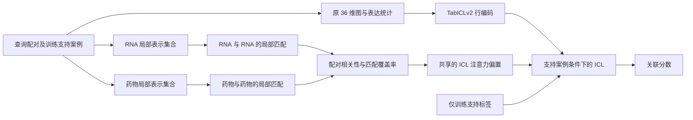

# 从 miRNA 出发的通用改动：局部证据匹配与 TabICLv2

2026-09-12 验证更新：共享的固定局部匹配原型已经实现，并完成三个推理种子的内部比较与 21 个状态的完整重放。MiDrug 四档强度的 AUC/AP 均上升，但 LncDrug 均有指标下降，没有候选通过共同门槛。实验选择 `zero`，未进入外层评价。见 [当前验证说明](../../TABICL_RELI.md) 和 [完整分数](../../results/tabicl_reli_20260912/REPORT.md)。

输入也已补齐：605/605 个成熟 miRNA 完成当前/历史 miRBase 名称与 MIMAT 核对；lncRNA 找回 1,292 条完整注释转录本。局部与池化对照共用这些输入。下面正文保留方案提出时的审计状态和研究设计，其中“尚未解决”和“待验证”描述的是方案阶段；可学习投影、共享训练及家族/骨架/迁移实验目前仍未完成。固定探针不等于完整可学习架构，已有结果也不支持强泛化结论。

方案与本次验证均未打开原始测试数组，也未继续已停止的 MiDrug 专用记忆实验。

**推荐研究“局部证据如何决定上下文案例的相关性”。** miRNA 提供了一个明确切入点：成熟链、seed 区及非 seed 区的局部差异可能影响识别与调控；长 lncRNA 则包含分散的局部信息。共同的计算问题是，实体在与其他实体比较之前被压成一个向量，可能丢失有用的局部证据。这个假设需要在相同输入下检验，不能仅凭生物学直觉认定它解释了当前误差。

建议暂名 **RELI-TabICL：Relational Evidence Late Interaction for TabICL**。新模块保留 RNA 和药物的局部表示，比较查询配对与支持案例，再用匹配结果调整 TabICLv2 的案例注意力。MiDrug、LncDrug 共用模块权重和选择规则。研究目标是验证跨 RNA 类型、RNA 家族和药物骨架的可迁移性；“泛化很强”目前是目标。

“Late interaction”本身已有成熟先例。潜在贡献在于局部证据与关系式 ICL 的具体结合及其迁移证据，不能把接入 TabICL、增加序列特征或修改模型名称单独视为创新。

**值得借鉴的近期工作如下。** 日期区分在线发表、会议发表和预印本版本；阅读深度及检索记录另存于 [selected_sources.json](selected_sources.json)。

| 工作 | 已有证据 | 对本项目的启发与边界 |
|---|---|---|
| [miRBind2](https://doi.org/10.1093/bioinformatics/btag410)，Bioinformatics，2026-08-21 在线发表 | 对 miRNA–靶序列建立核苷酸两两交互表示；作者将结合位点模型迁移到转录本抑制预测。已核验摘要、DOI 和官方实现说明，未取得出版社全文 | 保留局部配对信息、用机制任务提供监督有依据。它预测的是 RNA 靶标与抑制，不能直接当作药物关联预测器 |
| [DuplexFM](https://doi.org/10.64898/2026.08.06.743413)，bioRxiv，2026-08-12，预印本 | 全文方法与结果显示：冻结 miRNA 交互表示，只训练小型头，迁移到 siRNA 效率预测；六个设置均优于描述符对照，专用 OligoFormer 在两个数据集仍更强 | “冻结交互表示＋轻量迁移”最贴近可迁移机制。miRNA、siRNA 共享 Argonaute 识别基础；这项证据不覆盖 lncRNA |
| [MiRformer](https://doi.org/10.1093/bioinformatics/btag222)，Bioinformatics，2026-07-07 在线发表 | 双编码器及窗口注意力；官方实现使用成熟 miRNA 与 mRNA，并涉及位点定位。已核验摘要及代码说明 | 支持成熟链和局部位置分辨率的重要性。不能据此声称又加一个 Transformer 就有方法新意 |
| [LILaC](https://aclanthology.org/2025.emnlp-main.1037/)，EMNLP 2025，2025-11 | 官方会议条目已核实；全文通过细粒度子组件的 late interaction 评分支持多模态检索，在五个基准上评价 | 将“先压成一个向量再比较”改成“先比较局部证据再汇总”。其图遍历和 LLM 查询分解不是本项目必要组件 |
| [MatchAnything](https://arxiv.org/abs/2501.07556)，2025，按已核验 arXiv 版本引用 | 全文通过合成跨模态监督和多来源预训练，使同一组权重用于八种以上未见图像模态匹配任务 | 泛化来自适当的共同任务与训练分布。不能把图像配准结论外推成 RNA 泛化，也不能随意把 RNA 突变当作保持功能的数据增强 |
| [miRBench](https://doi.org/10.1093/bioinformatics/btaf233)，Bioinformatics，2025-07-15 在线发表 | 揭示 miRNA 频率类别偏置，并改进负例构造；已核验摘要及 DOI | 强化模型前先排除实体频率、家族重复和负采样捷径。单一随机边划分不足以支撑强泛化叙事 |

另一条新方向是用稀疏自编码器解释 RNA 基础模型。[PNAS 的蛋白质 SAE 工作](https://doi.org/10.1073/pnas.2506316122)提供了可解释特征的证据；但 [SAE-RNA v2](https://arxiv.org/abs/2510.02734v2) 全文明确指出特征稳定性、长度归一化和信噪验证尚未解决。因此它适合作为探索性解释分析，暂不承担本项目的主架构。[RIBOSPAN](https://arxiv.org/abs/2608.22849)可作为后续长 RNA 编码器候选，其 10,240 nt 上下文目前只核验了摘要与版本信息；单纯替换成更大编码器也不是本方案的贡献。

**本地输入审计给出了具体动机，也暴露了实施前提。** 审计只读取实体名称、序列和已有嵌入，没有读取关联标签。

| 项目 | 实际发现 | 对下一步的影响 |
|---|---|---|
| 现有 miRNA 序列 | 602/605 个节点有序列，长度中位数 88 nt；提取流程移除链臂后取前体。54 组同名 stem 的 5p/3p 使用相同序列 | 需恢复成熟链分辨率。不能靠从前体任意截取 22 nt 修复 |
| 官方成熟序列对齐 | 从 miRBase 下载的快照中，417/605 个节点可按完整名称忽略大小写精确匹配；成熟链长度 19–25 nt，中位数 22 nt | 这 54 组 5p/3p 在精确匹配后全部具有不同的成熟序列。结果已单独导出，没有覆盖原数据 |
| 未解决名称 | 188 个；其中 175 个有追加链臂后的候选，13 个连这种候选也没有 | 候选不等于确定映射。需用历史名称、MIMAT 编号或原始记录核对；保留缺失掩码，不挑选有利子集 |
| lncRNA | 主 FASTA 的 1,307 条中有 815 条恰好为 1,022 nt；`all` 与主文件相同，`fill` 也没有超过 1,022 nt 的序列 | 三个现有文件均不能恢复被截断区域。完整序列需要重新追溯来源；窗口编码应在获得完整输入后进行 |
| 药物功能数据 | 本地 ChEMBL 文件有 105 个 molecule ID 的机制记录、116 个 target 条目；不能把它们当作 216 种药物的完整覆盖 | 可用于后续调控证据版本；目前不足以直接建立完整的共同基因程序空间 |

这里的序列缺陷不是当前 36 维图/表达统计 TabICL 的直接输入错误。该基线未使用 RNA-FM 序列通道，因此不能宣称修复序列必然提高它。此前已有 RNA-FM 全序列池化特征实验；本方案必须与使用相同修正序列的池化对照比较。

复核材料：[原输入审计](input_audit.json)、[成熟序列与 lncRNA 审计](mature_input_audit.json)、[逐节点映射](mature_alignment.csv)、[精确匹配成熟序列](mature_exact.fasta)。官方快照来源及 SHA256 已保存；精确参考名称匹配仍不等于验证原实验中的 isomiR 或样本表达。

**第一版架构采用支持案例匹配，能用现有标签体系定义清楚。** 对查询 `q=(r,d)` 和训练支持案例 `s=(r',d',y')`，比较 `r` 与 `r'` 的 RNA 局部证据、`d` 与 `d'` 的药物局部证据。匹配权重不读取查询标签；支持标签 `y'` 仍通过 ICL 使用。



1. **保存局部表示。** 使用冻结 RNA 编码器的 token 表示，并保留局部位置。成熟 miRNA 保留完整链；lncRNA 采用有重叠的窗口，窗口内编码上下文，按固定规则形成局部单元。不同 RNA 类型使用同一编码器与匹配参数。药物侧先采用固定编码器的局部结构表示；SMILES token 不自动等价于化学子结构，正式实现需核验 atom 对齐或使用原子/子图表示。没有功能注释的单元称“局部证据”，不称“发现的功能 motif”。

2. **在汇总之前匹配。** 设两个实体的局部集合为 `U={u_i}`、`V={v_j}`，经同一模态投影后计算局部相似度 `c_ij`。RNA 与药物可以有各自的模态投影，但 MiDrug 和 LncDrug 共享所有这些投影及匹配规则。上下文仍在任务内部构建；共享算子不要求直接用 miRNA 与 lncRNA 的碱基片段互相替代。

3. **控制长度与无关片段。** 第一版使用带“无匹配”项的归一化软匹配，输出双向匹配得分、覆盖率等小量关系特征。一个可实现的参数化为：

   \[
   a_{ij}=\frac{w_j\exp(c_{ij}/\tau)}{\exp(b_0/\tau)+\sum_k w_k\exp(c_{ik}/\tau)},\qquad \sum_j w_j=1,
   \]

   \[
   m(U,V)=\sum_i v_i\sum_j a_{ij}c_{ij},\quad
   h(U,V)=\sum_i v_i\sum_j a_{ij},\qquad \sum_i v_i=1.
   \]

   `b0` 是无匹配分数，`h` 表示匹配质量分配的总量。重叠窗口按原始位置分配权重，避免同一片段重复出现就增加证据。这个算子没有强制一一对应，也不是已验证的生物学对齐或最优传输方法。长度归一化、无匹配项是否必要必须做消融；它们不能自动消除所有长度偏差。

4. **改变 ICL 的案例交互。** RNA 和药物匹配分别产生 `kR(q,s)`、`kD(q,s)`，由小型共享函数形成 `b(q,s)=fθ(kR,kD,kR*kD,coverage)`。在 ICL 的查询到支持注意力中加入该偏置：

   \[
   A(q,s)=\operatorname{softmax}_{s\in S}\{\ell_{\mathrm{TabICL}}(q,s)+\alpha b(q,s)\}.
   \]

   其中 `ℓTabICL` 保留原模型已有的缩放与掩码。第一版只改变查询到支持的交互，保持支持状态与查询批次独立。`α` 在两个任务共用；初始化为零仅用于工程回归检查。参数更新后 LncDrug 是否不下降由验证决定。

5. **共享适配。** 冻结基础编码器与 TabICLv2 主干，用两个任务平衡抽样的支持/查询 episode 学习一个小型匹配模块，不输入任务 ID。支持案例可按粗粒度实体属性预筛，再执行局部匹配；筛选规则、案例数量和计算预算必须与对照一致。不能把多取了案例或多跑了模型造成的收益归给局部机制。

本方案的 RNA 比较发生在 RNA 与 RNA 之间，药物比较发生在药物与药物之间，因此没有假设 ncRNA–药物关联标签意味着直接物理结合。局部相似也不等于功能等价；这是需要通过外推实验和局部扰动实验检验的模型归纳偏置。

实现入口已做只读检查：当前安装版本的 `tabicl/_model/learning.py` 提供 ICL 行学习，`layers.py` / `attention.py` 支持附加注意力掩码；上层还需显式传递关系偏置。非空 mask 会跳过该实现的 FlashAttention3 快速分支，计算开销需实测。实现应放在项目内的适配模块，不直接修改环境中的第三方包。零偏置、缓存重放、支持顺序对齐、查询换序及分批一致性是这一改动必须验证的工程性质，当前尚未声称这些检查已通过。

**更强的生物机制版本有明确的数据前提。** 后续可以将实体都映射为有来源和置信度的基因/调控程序证据：miRNA 通过成熟链–靶位点识别，药物通过靶点与作用机制，lncRNA 通过经过核验的调控或 RNA–蛋白证据。此时可用同一个匹配算子比较共同程序。miRBind2/DuplexFM 适合作为 miRNA 侧来源之一，但不能替 lncRNA 生成未经验证的靶基因。本地尚未发现覆盖这两类 RNA 的完整基因注释，因此不把这个版本描述成已经能直接训练的方案，也不将它和第一版同时堆入模型。

**与已有工作的边界需要写在立项之前。**

| 已有工作或本地实验 | 已覆盖的内容 | 本方案需要额外证明的内容 |
|---|---|---|
| [MIFNDRA](https://doi.org/10.1093/bib/bbag322)，2026-06-17 在线发表 | 预训练 RNA/药物表示、多模态融合、跨 ncRNA 网络与图学习 | 使用相同实体输入时，局部案例匹配是否仍带来独立贡献 |
| [DC-MetaMG](https://doi.org/10.1109/JBHI.2026.3717803)，PubMed 电子发表 2026-07-28 | 双粒度表征、静态结合与动态调控机制，两类 RNA–药物任务 | 不能用“局部＋全局”“双分支调控”概括创新；要评价具体的 ICL 关系算子 |
| [RGDAGMAE](https://doi.org/10.1016/j.compbiolchem.2026.109236)，PubMed 电子发表 2026-07-13 | miRNA–药物注意力路由、图掩码重建、全局/局部融合 | 路由、门控、去噪本身不构成本方案的新贡献；期刊卷期标为 10 月不意味着 9 月尚未公开 |
| [TFMLinker](https://arxiv.org/abs/2602.08592)，2026 预印本 | 原型增强的局部/全局上下文、拓扑链接编码、通用图 ICL | 需要在局部证据进入 ICL 交互的位置和泛化验证上区分；通用图 ICL 已有先例 |
| 本地 RNA-FM 池化、TabICL 图上下文、MiDrug 记忆实验 | 实体特征、支持图一致性、药物原型检索与局部专家 | 这次应直接比较未汇总的查询/支持证据，且同一非零改动用于两任务；不再采用 LncDrug 专用恒等路径 |

本轮补充检索还发现 [IsoNet++](https://arxiv.org/abs/2510.22538)，它在子图检索中通过迭代 early interaction 改进已有 late interaction 方法。因此不能声称“晚交互普遍优于早交互”；早期跨注意力是需要保留的同预算对照。检索是有界研究检索，未找到精确同名方案不等于已经证明全球首创。

**实验首先要分开“修正输入有用”和“新算子有用”。** 以下是待冻结的设计，不是已执行或已预注册的实验结果。

| 对照 | 目的 |
|---|---|
| 当前 36 维 TabICLv2 与图上下文基线 | 保留实际强对照，不回退到较弱历史模型 |
| 修正成熟链/完整 lncRNA 后，全局池化并使用同等预算的适配头 | 量化新增数据与输入修正的作用 |
| 相同输入、相同支持案例，用全局向量形成 ICL 注意力偏置 | 隔离“改了 ICL 注意力”与“保留局部信息”的贡献 |
| 局部 MaxSim、归一化软匹配、带无匹配项的软匹配 | 判断具体算子的必要性，不把所有组件默认保留 |
| 同等参数与计算预算的 early cross-attention | 检查晚交互的性能与效率取舍 |
| 相同局部算子，用简单支持标签加权读出代替 TabICL | 检查 ICL 的必要性，避免新模块实际上已经独立完成分类 |
| 在实体间打乱局部证据归属，同时控制长度和数量 | 排查实体频率、长度与缺失模式的捷径；实体内部单元换序另作为不变性检查 |

若“修正序列＋池化”已经获得全部增益，应将结果归于输入质量；若简单加权读出与 TabICL 相当，应重新评价 TabICL 的必要性。两者都不能支持预定的新架构叙事。

**泛化验证采用真正改变实体分布的设置。**

1. MiRNA family/seed 分组留出：同家族、同 seed 及高度相似成熟链不能随意分散到两侧；分组信息不使用药物标签。LncRNA 对应使用同源/近重复与转录本来源分组。未解决名称单独报告覆盖情况。
2. 药物 scaffold 留出：骨架分组在两任务的药物并集上构建；严格冷药物实验需同时移除另一任务中该药物的监督边，避免跨任务通道泄漏。
3. 参数迁移：只在 MiDrug 学习匹配参数，然后冻结，在 LncDrug 使用目标任务训练支持案例进行 ICL；再做反方向。这里仍使用目标支持标签，应表述为“不更新目标任务参数”，不能称作“目标任务零样本”。与两任务联合训练分别报告。
4. 身份与频率对照：只用实体度数/身份的简单模型，另做训练度数控制下的负采样敏感性分析；不把采样的未观测边等同于实验确认的阴性。
5. 使用至少三份独立数据划分，报告逐划分配对差异及按药物/家族聚类的不确定性。原有 seed 666/0/1 是同一历史划分下的推理随机性，不是三份独立泛化重复。基础模型预训练中可能见过序列，因而“下游家族留出”也不等于“所有预训练阶段从未见过该序列”。

训练图、局部上下文、预处理统计和图视图必须只由相应支持集构造；查询正边及反向边均排除。选择候选只能使用内部划分，最终协议冻结后才评价独立外层数据。当前历史外层验证已多次用于开发，不能继续把它称为全新的验证集。本轮研究不打开原始测试数组。

**LncDrug 不下降是共同选择约束。** 历史参考值如下，仅用于说明对照口径，不是本方案新结果：

| 任务 | 参考 | AUC | AP | 按药物宏 AP |
|---|---|---:|---:|---:|
| LncDrug | 原 TabICLv2 | 0.985403 | 0.968115 | 0.878353 |
| LncDrug | 图上下文 TabICLv2 | 0.985742 | 0.968844 | 0.862695 |
| MiDrug | 原 TabICLv2 | 0.959524 | 0.924198 | 0.718572 |
| MiDrug | 图上下文 TabICLv2 | 0.959934 | 0.925057 | 0.717259 |

来源：[图上下文实验说明](../../TABICL_GRAPH_CONTEXT.md)。图上下文在全局 AUC/AP 上更强，但按药物宏 AP 较低；因此不宜笼统称为所有指标上的最佳模型。

按用户“不下降、涨幅不重要”的偏好，建议保守选择：在每份新划分上重跑两个参考，用 LncDrug 各指标较强的参考定义零退化门槛；对共享候选要求 LncDrug 的 AUC、AP、按药物宏 AP 配对平均差值均不为负，MiDrug 的 AUC/AP 相对图上下文参考为正。计算预算和候选数量预先固定；不以 MiDrug 增益抵消 LncDrug 退化。若没有共享非零候选通过，应记录失败。

这个门槛只能筛选有限验证集上的候选。未来分布中绝对不下降不能由模型结构保证；严格统计上的非退化结论还需相应置信区间支持。最终报告必须区分观察到的差值与统计证据，也须报告单类药物等指标不可定义时的处理及覆盖数量。

**实际推进顺序已经收敛。** 先核对 188 个成熟链名称、追溯完整 lncRNA，并缓存位置可追溯的局部表示；随后做相同输入下的全局/局部信息探针；有独立信号后实现共享 ICL 注意力偏置；最后进行 family、scaffold 和跨 RNA 参数迁移。第一轮不同时引入大模型替换、SAE、最优传输和多专家路由。资源投入依据数据覆盖与前一步证据决定。

检索入口包括 PubMed、CrossRef、arXiv，OpenAlex 仅作补充发现；主检索 13 个查询，原始返回经去重得到 95 条发现记录，再对选定文献核验。全文重点核读包括 DuplexFM、LILaC、MatchAnything、SAE-RNA；其余阅读深度见来源索引。miRBind2 出版社 PDF 访问失败已记录；LILaC 后经官方 ACL 条目确认会议与 DOI；DuplexFM 经 bioRxiv 官方 API 和 JATS 核实，未把最初的 CrossRef 限流当作不存在。

可复核文件：[来源索引](selected_sources.json)、[BibTeX](references.bib)、[原检索与去重](primary_discovery.json)、[补充近似工作检索](architecture_prior_check.json)、[全文取得记录](fulltext_followup.json)、[成熟输入审计脚本](audit_mature_inputs.py)。

```bash
python improve/research/mirna_general_architecture_20260912/audit_mature_inputs.py
```

该命令只重建研究目录中的映射与审计文件，不改动原序列、既有模型、实验选择或原始训练/验证/测试数组。
