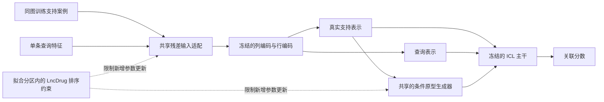

# TabICLv2 下一轮：共享输入适配与条件原型记忆

检索与核对日期：2026-09-13。

**下一轮优先验证“共享残差输入适配器 + 受约束更新”，然后检验由支持集生成的原型记忆。** 两个模块若各自有证据，再组合为新的 TabICLv2 架构。另一条更长期的研究路线是显式建模正例与未标注数据，但现有 PUICL 的假设和推理方式需要调整。

本轮核对了 9 篇不同论文的全文方法、实验或限制，另下载并核对了 BETA 的 ICML 正式版，以及 BETA、PUICL 的关键源码。**本轮没有启动新的性能选参实验；输入适配器已通过两个拟合数据接口探针，尚无新增 AUC/AP 收益证据。** 当前模型仍为现有图上下文 TabICLv2。

用户确认的硬约束保持为：相对现有图上下文 TabICLv2，LncDrug 的 AUC、AP 均不得下降；按药物宏 AP 单独报告。MiDrug 追求小幅有效提升，优先选择改动较小的合格方案。共享新增权重，不为 LncDrug 设置身份恒等分支。

## 本地证据如何影响取舍

| 已有证据 | 对下一轮的具体影响 |
|---|---|
| CARE 第二轮的 MiDrug AUC/AP 为 3/3 推理种子提升，LncDrug AUC 为 3/3 下降 | 存在改进与保护之间的冲突；仅调小强度或提高软惩罚尚未解决 |
| CARE-RO 已加入支持比例归一化、教师排序保持，全部候选的 MiDrug AP 下降 | 新实验需要区分约束优化、输入适配和原型内容三个因素 |
| 历史训练审计：LncDrug 前五种药物占正例 78.99%，MiDrug 为 31.33% | 支持证据集中程度差异很大；适合研究支持集条件化，不能据此直接断言频率是退化原因 |
| 两任务都是 36 维，但仅前 31 列的特征名称和角色一致 | 共享输入适配首先作用于这 31 列；其余 5 列需保持各自语义，或先建立显式的角色映射 |
| 当前负标签来自 `RandomLinkSplit(neg_sampling_ratio=2.0)` 的未观测配对采样 | 数据集中的正例比例不是生物学类别先验；PU 方法需要采样与标注机制审计 |

依据：[三轮结果](../../TABICL_CARE_FINDINGS.md)、[历史训练分布审计](../innovation_directions_20260910/feasibility.json)、[本轮列语义与接口记录](input_adapter_probe.json)、[原始划分代码](../../../heter_data_prepare.py)。

## 文献筛选结果

优先级表示与本项目的适配程度、验证成本和已有实验的互补性，不表示已经量化的成功概率。论文的平均 Accuracy 或其他任务上的 AUC，不能直接换算为本项目的预期涨幅。

| 论文与状态 | 核对到的实际机制及边界 | 本项目判断 |
|---|---|---|
| **[BETA / TabPFN Unleashed](https://proceedings.mlr.press/v267/liu25cn.html)，ICML 2025** | 冻结 TabPFN，学习支持与查询共用的输入编码器，结合 BatchEnsemble 和支持集重采样。正式版附录 D.3 明确报告：完整 TabPFNv2、TabICL 的平均排名优于原 BETA | **优先借鉴输入适配机制，在当前 TabICLv2 上检验**；原 BETA 本身不是已知更强的替代品 |
| **[TuneTables](https://arxiv.org/abs/2402.11137)，NeurIPS 2024** | 学习连续的上下文 token；研究保留真实上下文和只保留学习上下文两种设置。原方法的 prompt 通常针对单个数据集优化，包含 Accuracy/公平性多目标实验 | **第二优先：支持集条件化的共享原型生成器**；固定数据集 prompt、压缩和公平性实验不等于跨 RNA 任务共享或性能保护 |
| **[GEM](https://arxiv.org/abs/1706.08840)，NIPS 2017** | 将旧任务记忆上的损失写成不等式，并把更新投影到满足一阶条件的方向 | 作为训练保护机制；约束对象是有限训练记忆上的损失，不是外层 AUC/AP |
| **[I-GEM](https://arxiv.org/abs/2601.02500)，2026-01 预印本** | 在 LoRA 参数空间近似求解 GEM 投影；主体实验证据来自 GPT-2 的三任务 AG News 设置 | 说明小参数空间中执行投影可行；当前只有少数保护约束，先采用可核验的小型投影，无需照搬其近似求解器 |
| **[PUICL](https://arxiv.org/abs/2605.05591)，2026-05 预印本** | 为未标注样本设计独立标签 token，按 PU 合成先验预训练；允许所有样本相互注意。论文假设 SCAR，训练特征数最多 20，主要实验为半合成 PU 数据 | 长期路线有针对性，但直接替换会改变查询独立性；标注机制、规模与评价标签也不同 |
| **[KnowsTFM](https://arxiv.org/abs/2606.30258)，2026-06 预印本** | 将知识图谱先验加在特征注意力上，并训练 LoRA。小型专用模型受益；其一般领域实验中 TabICLv2 平衡准确率由 0.763 降到 0.749 | 提供重要反证：知识注意力不自动改善强基础模型。当前 36 列主要是图统计，也不能直接当作基因列接入 PrimeKG |
| **[CRUMB](https://arxiv.org/abs/2606.11473)，2026-06 预印本** | 聚类测试查询，再用 MMD 同时衡量相关性与冗余，选择上下文；与相同上下文预算下的采样方法比较 | 可借鉴多样性选择；原法需要整批查询，且主要处理大上下文效率。流式固定中心版本在原文也被指出可能丢失分布匹配优势 |
| **[KernelICL](https://arxiv.org/abs/2602.02162)，2026-02 预印本** | 重算对称的上下文/查询表示，用核函数对训练标签加权读出；包含合成任务微调，不是直接把冻结表示接一个核就等价复现 | 适合解释与诊断；原文重点是保持竞争力和可检查性，未给出严格优于当前 TabICLv2 的依据 |
| **[SkillTFM](https://arxiv.org/abs/2608.06137)，2026-08 预印本** | 外部修正规则经验证后启用，失败保留原模型；主要证据来自受控边界任务及一个受限电价案例 | 有助于记录与限制搜索，但本质上是外部适配系统。其允许退化幅度与伤害率的定义不能替代用户要求的两项指标均不下降 |

额外核对的相关工作包括 [StablePFN，KDD 2026](https://doi.org/10.1145/3770855.3818030)，以及同领域的 [MPHGNN，Briefings in Bioinformatics 2026](https://doi.org/10.1093/bib/bbag013)、[RGDAGMAE，Computational Biology and Chemistry 2026](https://doi.org/10.1016/j.compbiolchem.2026.109236)、[MVGSCA，IEEE TCBBIO 2026](https://doi.org/10.1109/TCBBIO.2026.3729865)。这些额外条目本轮以元数据、摘要为依据。StablePFN 需要在合成阶段提供 Markov Boundary 监督；后三篇已覆盖基因介导图、路由注意力、掩码自编码器和谱编码。因此，新增这些模块名称本身不足以支撑方法新意。

## 方案一：共享残差输入适配，优先做

**研究问题：当前图特征是否需要先变换到更适合 TabICLv2 的表示，而不是继续修改支持案例之间的注意力？** BETA 的贡献提供了这个可检验的切入点。过去的 TabICL 全量/ICL 层微调、CARE 行注意力偏置、TabM 数值嵌入都没有直接检验“冻结完整 TabICLv2，仅学习输入变换”。

最小结构保留 36 维输入。令 `x_core` 为语义一致的前 31 维，使用

\[
z_{\rm core}=x_{\rm core}+U\tanh(Vx_{\rm core}),\qquad
z_{\rm tail}=x_{\rm tail}.
\]

`V ∈ R^(8×31)`、`U ∈ R^(31×8)`，无偏置时共 496 参数。`U` 初始化为零。两个任务共用 `U,V`；支持与查询应用同一变换。后 5 列保持原有输入，避免把不同关系的度数强行共用一个坐标含义。保留现有任务各自的预处理和图上下文配置。

后续可单独检验支持集条件化：`z_core = x_core + U[g(c_S) ⊙ tanh(Vx_core)]`。`c_S` 仅使用支持集的观测标签比例、支持分散程度和特征尺度等统计，不使用任务名、RNA 类型或查询标签。该扩展是本项目的设计假设，BETA 未直接验证它。

**本地接口已经验证：** 使用实际官方检查点，每任务从同一遮边折的拟合行中取 96 个支持案例、32 个伪查询；未进行优化器更新。

| 检查 | LncDrug | MiDrug |
|---|---:|---:|
| 零初始化与同一张量路径基线的最大 logit 差 | 0 | 0 |
| 适配器梯度范数 | 2.9563 | 12.7293 |
| 主干是否产生参数梯度 | 否 | 否 |

三个主干模块的参数哈希在检查前后完全一致。梯度大小不表示预期收益。该探针采用小样本、单成员、数学 SDPA 和支持集标准化，**不等于完整 32 成员图上下文流程已完成集成或回归验证**。约 431 MiB 的探针峰值也不能外推为正式训练显存。

实现时必须处理两个问题：第一，带固定列语义的适配器应在规范列顺序下执行，随后再进行 TabICL 的特征置换；如果接入已置换的张量，应显式还原与重新应用置换。第二，输入变化会使列/行表示和 KV 缓存失效，训练时必须重算；CARE 的最后一层缓存不能直接复用。推理阶段可在适配参数固定后重新建立缓存。

## 保护 LncDrug：把更新方向写成约束

这是配合新模块的训练方法，不能单独算作新的网络架构。

在拟合分区内固定 LncDrug 记忆 episode，定义全局 AUC 与 AP 的可微排序代理损失 `R_L,auc`、`R_L,ap`。MiDrug 的目标更新记为 `d0`，投影求解

\[
\min_d\ \tfrac12\|d-d_0\|^2,
\quad\text{s.t.}\quad
\nabla R_{L,\mathrm{auc}}^\top d\le0,
\quad\nabla R_{L,\mathrm{ap}}^\top d\le0.
\]

这与 CARE-RO 的软教师排序惩罚不同：投影直接限制本次可采用的参数更新方向。AUC 代理可使用正负配对的平滑排序损失，AP 代理需对应全局排序；它们仍不是实际的离散 AUC/AP。

工程上先使用简单的实际参数步长；若用 AdamW，应投影包含动量、预条件与衰减后的**实际更新量**，不能只投影原始梯度后再交给 AdamW。每步还需在固定训练记忆上检查实际代理损失，必要时缩步或跳过，以处理有限步长的一阶近似误差。`d=0` 始终可行，因此也可能没有有效学习进展，必须记录投影后更新范数及跳步率。

**这一机制只约束训练记忆上的局部变化。** 新数据的 AUC/AP 仍必须按原规则验收。训练保护集来自拟合分区，不能把内部或外层验证标签用于求梯度。正式比较保留无投影对照，判断约束是否确实减少 LncDrug 退化，以及是否同时消除了 MiDrug 的收益。

## 方案二：由支持集生成原型记忆

**研究问题：MiDrug 是否缺少合适的上下文表示，而不只是已有案例的权重不合适？** TuneTables 学习新的上下文向量，提供了与 CARE 不同的操作对象。此前 TFMLinker 提案也提到过全局可学习原型，本方案进一步检验由当前支持集生成的原型。

令 `h_i` 为同图支持案例通过冻结列/行编码器得到的表示。每个标签组使用相同的原型查询参数，生成少量原型：

\[
p_{c,j}=\sum_{i\in S:y_i=c} a_{ij}(H_S)h_i,
\qquad a_{ij}\ge0,\quad\sum_i a_{ij}=1.
\]

第一版可取每组 8 个原型。生成器在两个任务之间共享；原型内容随支持集变化。相同的生成规则用于两个标签组，以保持类别置换的一致性。这里的零标签仍是基准中的采样未观测配对，原型不代表实验确认的阴性机制。

原型与真实支持记忆共同进入 ICL，使用一个共享强度控制原型贡献。关闭原型时，必须从注意力归一化中完整屏蔽其 key；仅把向量置零仍会改变 softmax 分母，不能恢复基线。生成过程不读取整批查询分布，使单条预测不依赖同时提交的其他查询。

最小对照包括：无原型、固定全局可学习原型、均匀类均值原型、支持集条件原型。各对照使用相同真实上下文、原型数和推理预算。只有“条件生成”确实优于简单原型，才有证据支持这部分设计。它与输入适配应先分别验证。

潜在完整结构如下，尚未完成训练实现：

输入适配、prompt、原型和梯度投影各有先例。可能的研究增量是：同图支持条件化、跨 RNA 任务共用新增参数，以及同时满足两任务目标的实证。仅把这些部件组合、命名，不能宣称首创或强泛化。

## 方案三：观测机制感知的 PU 上下文，长期研究

PUICL 的独立未标注 token 直接针对“零标签不等于真正阴性”的问题，其官方作者仓库已有约 14.9 MB 的打包检查点。它值得研究，但不适合作为当前最小改动的首选：

1. 论文采用 SCAR，即已标注正例与未标注正例具有相同条件特征分布；本项目中的被研究药物、RNA 和记录过程是否满足它，尚未识别。
2. 论文训练最多 20 个特征、几百个正例；仓库当前配置写的是 5–24 个特征。二者都没有为本项目 36 维与数千支持案例提供直接证据，不能混用论文与仓库的不同实验设置。
3. 原法对正例与未标注池做全注意力，未标注案例相互影响；这和本项目已有的查询独立性要求不同。
4. 本项目验证中的零标签也是采样未观测配对。改善真实潜在关联识别，未必提高这一观测标签口径下的 AUC/AP。

一个可研究的改造是固定仅来自拟合分区的未标注参考池，让外部查询只能读取支持与参考池；并在合成先验里显式加入端点相关的标注过程。若采用这种改造，就需要重新训练/适配并验证，不能沿用原文成绩声称已解决问题。拟合标签比例不能直接填作真实类别先验。

还需注意官方接口 `score_unlabeled` 返回 `probs[:, 1]`，README 将其定义为 outlier/negative 概率；若用于正关联排名，需明确类别方向。代码已核对，本轮未下载或运行其模型权重。

## 建议的最小实验顺序

以下是待实现的设计，尚未冻结为正式实验协议。

| 顺序 | 比较 | 主要回答的问题 |
|---|---|---|
| 1 | 原模型；共享输入适配；相同适配加排序梯度约束 | 输入变换是否产生 MiDrug 增益；保护是否有效 |
| 2 | 条件化输入适配与无条件适配；必要时比较多编码器 | 支持分布条件化和成员多样性是否有额外作用 |
| 3 | 简单原型、固定可学习原型、支持集条件原型 | 新增记忆内容是否优于单纯增加容量 |
| 4 | 输入适配与条件原型的组合 | 两种机制是否互补 |

每阶段保留零改动对照。总推理成员、图视图和前向预算与基线匹配；增加四个编码器时不能把总推理预算无声地扩大四倍。支持与伪查询继续在同一遮边图上构造，目标正边及反向边均不得可见，查询与支持案例互斥。

内部先锁定方案，再评价外层。沿用已有约定：LncDrug 平均 AUC/AP 不低于图上下文参考，并保留原始 TabICLv2 在内部更强时的参考包络；MiDrug 平均 AUC/AP 均为正增益，每项至少两个推理种子为正。按药物宏 AP 完整报告。任何负差值都不能通过四舍五入改写为“持平”。

当前单任务图协议允许另一任务的关联作侧信息。若进一步宣称跨任务迁移，需要另外审计两任务同时遮边；共享参数本身不是迁移验证。历史外层划分已被反复查看，新种子和重新切分不能自动成为独立外部证据。

## 核验与复核入口

- [选中文献及核验深度](selected_sources.json)：区分正式发表、预印本、全文依据和摘要依据。
- [检索汇总](DISCOVERY_SUMMARY.json) 与 [去重后的发现记录](deduplicated_discovery.json)：保留无关命中与失败来源，不把搜索命中数当作精读数。
- [正式版 BETA PDF](PDFs/Liu_2025_ICML_Beta.pdf)、[正式版核验清单](beta_icml_manifest.json)；9 篇论文的 HTML 全文及提取文本保存在 `fulltext/`。
- [官方源码核对清单](code_reading_manifest.json)、[输入适配接口代码](probe_input_adapter.py)、[探针结果](input_adapter_probe.json)。

检索采用 `nature-academic-search` 的多源流程；学术 MCP 未挂载，使用技能的 OpenAlex 回退脚本、Crossref、PubMed 和官方论文页面。arXiv 搜索 API 的超时与 429 已记录，精确论文页面可访问。全文使用 `nature-downloader` 的开放获取路径，仅下载 1 份正式论文 PDF，未获取补充附件。检索中一次错误的候选 arXiv 编号已按题名不匹配排除，正确 TuneTables 编号为 `2402.11137`。

现有实验代码、冻结协议、检查点及默认预测入口未修改。本轮交付的是有来源和接口证据的改进设计，不是已达标的新模型。
